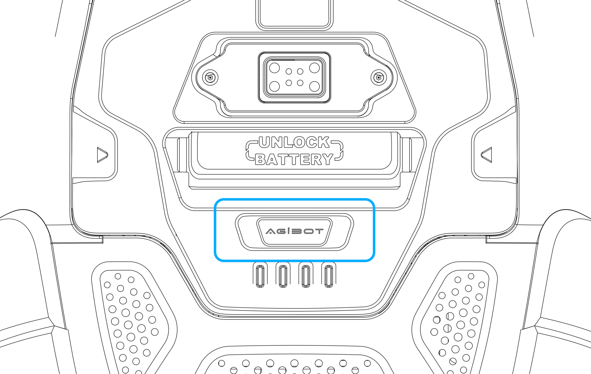
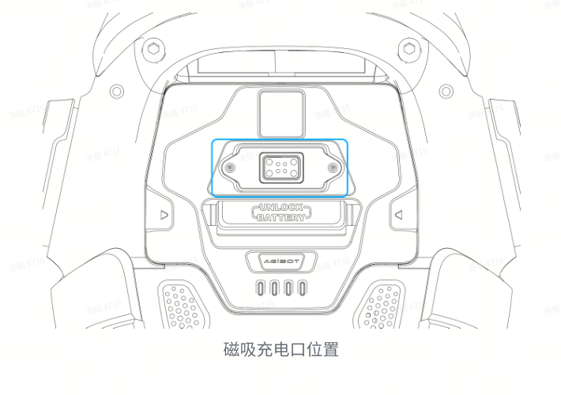

# AGIBOT X2 리모컨 사용설명서

X2 전용 리모컨으로 착석 고정, 일어서기, 이동, 팔 동작, 앉기와 관절 힘 해제를 진행합니다. 전원 켜기부터 아래 순서대로 따라 합니다.

화면의 버튼으로 조작할 때는 [대시보드 사용설명서](USER_GUIDE_KO.md)를 엽니다.

## 목차

1. [사용 전 준비](#prepare)
2. [리모컨 버튼 위치](#buttons)
3. [로봇 전원 켜기](#power-on)
4. [리모컨 연결하기](#connect)
5. [앉은 자세 고정하기](#seat-hold)
6. [의자에서 일어서기](#stand-up)
7. [이동과 회전](#movement)
8. [손 흔들기 등 팔 동작](#presets)
9. [정지하기](#stop)
10. [의자에 앉히기](#sit-down)
11. [관절 힘을 해제하고 전원 끄기](#power-off)
12. [충전하기](#charging)
13. [자주 발생하는 문제](#troubleshooting)
14. [매일 사용하는 순서](#daily)

## 1. 사용 전 준비

| 준비물 | 준비 방법 |
|---|---|
| X2 Ultra | 배터리를 장착하고 잔량을 50% 이상으로 준비합니다. |
| 전용 리모컨 | 충전하고 해당 로봇과 연결할 수 있도록 준비합니다. |
| 등받이 의자 | 높이 35~40cm의 단단하고 움직이지 않는 의자를 준비합니다. |
| 보조자 | 뒤쪽 손잡이를 잡아 기립·착석·힘 해제 중 자세를 지지합니다. |
| 전용 충전기 | 사용 후 배터리를 충전할 수 있도록 준비합니다. |

로봇 주변의 물건과 케이블을 치우고 팔과 다리가 움직일 공간을 확보합니다. 기립과 이동은 평평하고 단단한 바닥에서 진행합니다. 푹신한 카펫과 경사진 바닥은 피합니다.

## 2. 리모컨 버튼 위치

| 버튼 | 위치 |
|---|---|
| 가운데 로고 버튼 | 큰 터치패드 아래 중앙의 로고 버튼입니다. 리모컨을 연결할 때 사용합니다. |
| 방향키 ↑, ←, ↓, → | 리모컨 왼쪽의 십자 방향키입니다. |
| ×, □, △, ○ | 리모컨 오른쪽의 도형 버튼입니다. |
| 왼쪽·오른쪽 조이스틱 | 이동과 회전에 사용합니다. |
| L1, R1 | 리모컨 위쪽 왼쪽·오른쪽의 어깨 버튼입니다. |
| L2, R2 | L1·R1 뒤쪽의 트리거 버튼입니다. |
| Create | 큰 터치패드 **왼쪽의 작은 버튼**입니다. |

이 설명서에서 **↑**와 **←**는 십자 방향키를 뜻합니다. 이동은 조이스틱으로 조작합니다.

조합 버튼은 함께 누르고 짧게 놓습니다. 조이스틱을 움직일 때는 작은 범위에서 천천히 시작합니다.

## 3. 로봇 전원 켜기

### 3.1 의자에 앉힙니다

1. 의자를 평평한 바닥에 놓습니다.
2. 로봇의 엉덩이를 의자에 안정적으로 올리고 등을 등받이에 기댑니다.
3. 몸통과 무릎이 앞을 향하도록 정리합니다.
4. 양발바닥을 바닥에 밀착시킵니다.
5. 팔과 손이 의자·몸통·주변 물건에 끼지 않도록 정리합니다.
6. 보조자가 뒤쪽 손잡이를 잡아 몸통을 지지합니다.

OmniHand가 장착된 로봇은 의자에 앉은 상태에서 기립을 준비합니다.

### 3.2 배터리 전원을 켭니다

로봇 등쪽 배터리의 `UNLOCK BATTERY` 손잡이 아래에 있는 **AGIBOT 표시 부분**이 전원 버튼입니다.

1. 충전 케이블을 분리하고 배터리 장착 상태를 확인합니다.
2. 전원 버튼을 **짧게 한 번** 누릅니다.
3. 배터리 잔량이 50% 이상인지 확인합니다.
4. 같은 버튼을 **약 5초 동안 길게** 누릅니다.
5. 표시등이 켜지고 부팅이 시작되는지 확인합니다.
6. 보조자가 자세를 지지한 상태로 **약 1분** 기다립니다.

초기화가 끝날 때까지 조이스틱과 동작 버튼을 조작하지 않습니다.

## 4. 리모컨 연결하기

1. 리모컨 가운데 로고 버튼을 누릅니다.
2. 연결 표시를 확인합니다.
3. 리모컨이 켜지지 않으면 충전 상태를 확인합니다.
4. 연결이 되지 않으면 해당 로봇과 짝지어진 리모컨인지 확인합니다.

## 5. 앉은 자세 고정하기

1. 로봇이 완전히 앉아 있고 두 발바닥이 바닥에 닿았는지 확인합니다.
2. 보조자가 뒤쪽 손잡이를 계속 지지합니다.
3. 리모컨의 **방향키 ↑ + ×**를 동시에 짧게 누릅니다.
4. 관절에 힘이 들어가고 앉은 자세가 유지되는지 확인합니다.

이 단계에서 로봇은 의자에 앉은 자세를 유지합니다. 다음 단계에서 일어서기를 진행합니다.

## 6. 의자에서 일어서기

1. 앉은 자세가 고정됐는지 확인합니다.
2. 양발바닥이 바닥에 밀착됐는지 확인합니다.
3. 앞뒤로 일어설 공간을 확보합니다.
4. 보조자가 뒤쪽 손잡이를 지지합니다.
5. 리모컨의 **방향키 ↑ + □**를 동시에 짧게 누릅니다.
6. 보조자가 자세를 지지하면서 로봇이 일어서는 과정을 지켜봅니다.
7. 기립 동작이 끝나고 두 발로 안정적으로 서는지 확인합니다.

동작 중에는 같은 조합을 반복하거나 조이스틱을 움직이지 않습니다.

## 7. 이동과 회전

### 7.1 이동합니다

안정적으로 선 상태에서 왼쪽 조이스틱을 조금씩 움직입니다.

| 조작 | 동작 |
|---|---|
| 왼쪽 조이스틱 앞으로 | 전진 |
| 왼쪽 조이스틱 뒤로 | 후진 |
| 왼쪽 조이스틱 왼쪽으로 | 로봇 왼쪽으로 평행 이동 |
| 왼쪽 조이스틱 오른쪽으로 | 로봇 오른쪽으로 평행 이동 |
| 오른쪽 조이스틱 왼쪽으로 | 제자리에서 왼쪽 회전 |
| 오른쪽 조이스틱 오른쪽으로 | 제자리에서 오른쪽 회전 |

조이스틱을 놓아 중앙으로 돌아오면 이동·회전이 멈추는지 확인합니다. 좌우는 로봇이 바라보는 방향을 기준으로 합니다.

### 7.2 안정 서기를 선택합니다

이동을 마치고 팔 동작을 사용할 때 진행합니다.

1. 양쪽 조이스틱을 놓고 로봇이 멈췄는지 확인합니다.
2. 로봇이 두 발로 서 있는 상태에서 **R2 + ×**를 동시에 짧게 누릅니다.
3. 서 있는 자세가 안정적으로 유지되는지 확인합니다.

## 8. 손 흔들기 등 팔 동작

1. 로봇을 멈추고 안정 서기를 준비합니다.
2. 팔 주변의 공간을 확보합니다.
3. 아래 표에서 원하는 동작의 버튼을 동시에 짧게 누릅니다.
4. 실제 동작이 끝날 때까지 기다립니다.
5. 다음 동작은 앞 동작이 끝난 뒤 진행합니다.

| 동작 | 왼손 | 오른손 |
|---|---|---|
| 손 흔들기 | **Create + L1 + △** | **Create + R1 + △** |
| 악수 | **Create + L1 + ×** | **Create + R1 + ×** |
| 손키스 | **Create + L1 + □** | **Create + R1 + □** |
| 경례 | **Create + L1 + ○** | **Create + R1 + ○** |

Create는 터치패드 왼쪽의 작은 버튼입니다. 버튼을 누르기 전에 해당 로봇의 리모컨 안내와 버튼 위치를 확인합니다.

## 9. 정지하기

### 9.1 이동과 회전을 멈춥니다

1. 양쪽 조이스틱에서 손을 뗍니다.
2. 조이스틱이 중앙으로 돌아왔는지 확인합니다.
3. 로봇이 멈추고 서 있는 자세를 유지하는지 확인합니다.

### 9.2 급히 정지해야 할 때

보조자는 로봇의 하중을 지지할 수 있도록 준비하고 주변 사람을 동작 범위에서 떨어뜨립니다.

| 조작 | 로봇 상태 |
|---|---|
| **L2 + R2 + Create** | 댐핑으로 전환합니다. 관절 저항이 남고 지탱하는 힘이 줄어듭니다. |
| **L1 + R1 + Create** | 영토크로 전환해 관절 힘을 해제합니다. |

영토크로 전환하면 로봇이 주저앉거나 넘어질 수 있습니다. 의자·등받이 또는 지지 장치와 보조자가 로봇을 지지하도록 합니다.

## 10. 의자에 앉히기

1. 이동과 팔 동작을 끝내고 안정 서기를 준비합니다.
2. 로봇 뒤쪽의 착석 위치에 높이 35~40cm 등받이 의자를 맞춥니다.
3. 보조자가 뒤쪽 손잡이를 지지합니다.
4. 리모컨의 **L2 + 방향키 ←**를 동시에 짧게 누릅니다.
5. 앉는 동작이 끝날 때까지 자세를 지지합니다.
6. 엉덩이가 의자에 완전히 닿고 등받이가 몸통을 지지하는지 확인합니다.

## 11. 관절 힘을 해제하고 전원 끄기

### 11.1 댐핑으로 전환합니다

1. 로봇이 의자에 완전히 앉아 있는지 확인합니다.
2. 등받이와 보조자가 몸통을 지지합니다.
3. **L2 + R2 + Create**를 동시에 짧게 누릅니다.
4. 힘이 줄어든 상태에서도 로봇이 계속 지지되는지 확인합니다.

### 11.2 영토크로 전환합니다

1. 보조자가 몸통과 팔의 하중을 계속 지지합니다.
2. **L1 + R1 + Create**를 동시에 짧게 누릅니다.
3. 관절 힘이 풀린 뒤에도 로봇이 의자와 등받이에 안정적으로 지지되는지 확인합니다.

### 11.3 배터리 전원을 끕니다

1. 배터리 전원 버튼을 **짧게 한 번** 누릅니다.
2. 같은 버튼을 **약 5초 동안 길게** 누릅니다.
3. 배터리 표시등과 로봇 전원이 꺼졌는지 확인합니다.

## 12. 충전하기

배터리의 **`UNLOCK BATTERY` 손잡이 위쪽**에 자석식 충전 단자가 있습니다.

1. 로봇 전원을 완전히 끕니다.
2. 전용 충전기의 연결 방법에 따라 전원을 준비합니다.
3. 충전 헤드를 자석식 충전 단자에 정확하게 맞춥니다.
4. 충전 표시가 들어오는지 확인합니다.
5. 충전 중에는 로봇 전원과 조종 기능을 사용하지 않습니다.
6. 네 개 표시등이 모두 계속 켜지는 충전 완료 상태를 확인한 뒤 충전 헤드를 분리합니다.

배터리를 분리해서 충전할 경우에는 전원을 끄고 로봇을 지지한 상태에서 배터리를 분리합니다. 충전 후 끝까지 삽입하고 체결 상태를 확인합니다.

## 13. 자주 발생하는 문제

| 증상 | 확인할 순서 |
|---|---|
| 리모컨 전원이 켜지지 않음 | 리모컨 충전 → 가운데 로고 버튼을 확인합니다. |
| 리모컨이 연결되지 않음 | 로봇 부팅 완료 → 해당 로봇과 짝지어진 리모컨인지 확인합니다. |
| ↑ + × 후 자세가 유지되지 않음 | 의자 지지 → 양발 접지 → 버튼 조합 → 리모컨 연결 상태를 확인합니다. |
| 일어서기가 진행되지 않음 | 착석 고정 완료 → 양발 접지 → 보조자 지지 → ↑ + □ 조합을 확인합니다. |
| 조이스틱을 놓아도 예상과 다르게 움직임 | 주변 공간과 로봇 지지를 확보하고 정지 조합으로 대응합니다. |
| 팔 동작이 실행되지 않음 | 조이스틱을 놓고 안정 서기 준비 → Create 버튼 위치 → 동작 조합을 확인합니다. |
| 앉기 동작이 진행되지 않음 | 안정 서기 → 의자 위치 → 이전 동작 종료 → L2 + ← 조합을 확인합니다. |
| 모든 리모컨 조작에 반응이 없음 | 연결과 부팅 상태를 확인합니다. 앞서 텔레오퍼레이션 작업을 했다면 장비 담당자에게 기본 운용 상태 복구를 요청합니다. |

## 14. 매일 사용하는 순서

### 시작

1. 의자·양발 접지·보조자 지지 준비
2. 배터리 버튼 짧게 1회 → 약 5초 길게 → 약 1분 대기
3. 가운데 로고 버튼으로 리모컨 연결
4. **↑ + ×**로 착석 고정
5. **↑ + □**로 의자에서 일어서기
6. 조이스틱으로 이동·회전하거나, 안정 서기에서 팔 동작 조합 사용

### 종료

1. 양쪽 조이스틱을 놓고 동작 종료 확인
2. 의자 위치와 보조자 지지 준비
3. **L2 + ←**로 의자에 앉기
4. **L2 + R2 + Create**로 댐핑
5. **L1 + R1 + Create**로 영토크
6. 배터리 버튼 짧게 1회 → 약 5초 길게 → 전원 꺼짐 확인
7. 충전

## 참고 문서

- [X2 Ultra t2d5 사용자 매뉴얼 v0.8.1](https://x2-aimdk.agibot.com/en/v0.8.1/_downloads/3d4e4f1753e055d54e7a7a19d6e524fb/x2_ultra_user_guide_t2.5_v0.8.1.pdf) — 의자 기립 24~26쪽, 착석 종료 34~35쪽, 충전 36~37쪽, 리모컨 39~44쪽.
- [대시보드 사용설명서](USER_GUIDE_KO.md)
- [프로젝트 README](../README.md)
