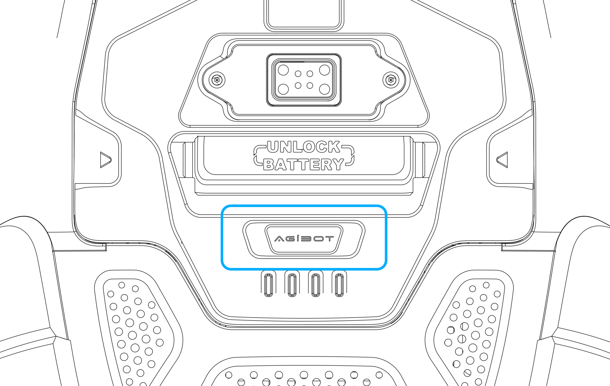
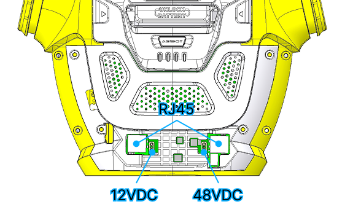
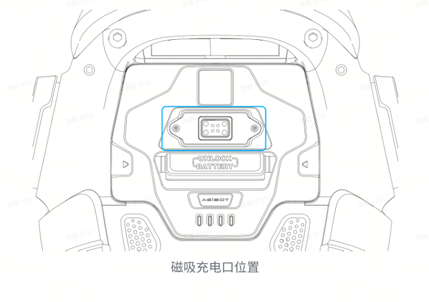

# AGIBOT X2 대시보드 사용설명서

이 문서는 대시보드의 버튼으로 로봇을 준비하고 조종하는 순서를 설명합니다. 처음 사용하는 PC는 [최초 설치 안내](FIRST_START_KO.md)에서 프로그램 설치·`.env`·유선 주소·SSH 등록을 마칩니다.

Windows PC, Mac, DGX Spark 중 사용하는 기기 한 대에서 Docker와 브라우저를 실행하고, 그 기기에 X2를 LAN으로 직접 연결합니다. 설치 이후 매일 확인할 짧은 순서는 [현장 사용 순서](OPERATIONS.md)에 있습니다. 리모컨 버튼으로 진행할 때는 [리모컨 사용설명서](REMOTE_CONTROL_GUIDE_KO.md)를 따릅니다.

| 사용할 기능 | 진행 순서 |
|---|---|
| 카메라·상태·라이다 보기 | 전원·LAN → 대시보드 실행 → 연결·최신 수신 확인 |
| 프리셋·이동 사용 | 연결 확인 → 착석 자세 고정 → 일어서기 → 제어 활성화 |
| VLM 사용 | OpenRouter 키 준비 → 모델·프레임 선택 → 계획 확인 → 현장 조건 확인 후 명령 전송 |
| 종료 | 동작 종료·이동 정지 → 제어 해제 → 의자에 앉기 → 댐핑 → 영토크 → 대시보드·전원 종료 |

## 목차

1. [사용 전 준비](#prepare)
2. [버튼과 연결 단자 위치](#buttons)
3. [로봇 전원 켜기](#power-on)
4. [PC와 로봇 연결하기](#network)
5. [대시보드 설치와 실행](#dashboard)
6. [로봇 제어 준비](#control-ready)
7. [프리셋 동작 사용하기](#presets)
8. [이동과 회전](#movement)
9. [VLM으로 명령하기](#vlm)
10. [정지와 제어 해제](#stop)
11. [의자에 앉히고 전원 끄기](#power-off)
12. [충전하기](#charging)
13. [자주 발생하는 문제](#troubleshooting)
14. [매일 사용하는 순서](#daily)
15. [라이다·카메라·센서 확인](#lidar)
16. [개인 키로 접속하는 경우](#ssh-key)

<a id="prepare"></a>
## 1. 사용 전 준비

다음 준비물을 갖춥니다.

| 준비물 | 준비 방법 |
|---|---|
| X2 Ultra | 배터리를 장착하고 잔량을 50% 이상으로 준비합니다. |
| 등받이 의자 | 높이 35~40cm의 단단하고 움직이지 않는 의자를 준비합니다. |
| 보조자 | 로봇 뒤쪽 손잡이를 잡아 기립·착석·힘 해제 중 자세를 지지합니다. |
| 개발 PC | Windows PC, Linux PC(DGX Spark 포함) 또는 Mac을 준비합니다. Git과 Docker를 설치합니다. |
| 전용 리모컨 | 충전하고 로봇에 연결해 즉시 정지할 수 있도록 준비합니다. |
| LAN 케이블 | PC에 유선 포트가 없으면 USB Ethernet 어댑터를 함께 준비합니다. |
| SSH 접속 정보 | 로봇의 계정, 비밀번호 또는 SSH 키를 준비합니다. |
| OpenRouter API 키 | VLM 명령을 사용할 때 준비합니다. |

로봇 주변의 책상, 의자, 케이블과 물건을 치우고 팔과 다리가 움직일 공간을 확보합니다. 기립과 이동은 평평하고 단단한 바닥에서 진행합니다. 푹신한 카펫과 경사진 바닥은 피합니다.

PC의 마우스와 키보드를 준비합니다. 움직임을 조작하는 운영자와 뒤쪽 손잡이를 지지하는 보조자가 함께 진행합니다. 로봇 부팅 후에는 [리모컨 연결하기](REMOTE_CONTROL_GUIDE_KO.md#connect)에 따라 리모컨도 연결해 운영자 손이 닿는 곳에 둡니다.

<a id="buttons"></a>
## 2. 버튼과 연결 단자 위치

### 2.1 배터리 전원 버튼

로봇 등쪽에 장착된 배터리에서 `UNLOCK BATTERY` 손잡이 아래의 **AGIBOT 표시 부분**을 찾습니다. 이 부분이 배터리 전원 버튼입니다. 그 아래의 네 개 표시등으로 배터리 상태를 확인합니다.



### 2.2 LAN 포트

로봇 **등쪽 배터리 아래의 개발 인터페이스 구역**에서 `RJ45` 포트를 찾습니다. RJ45는 일반 LAN 케이블이 들어가는 사각형 포트입니다. 외장 커버가 있는 기기는 해당 구역의 포트 덮개를 확인합니다.

아래 그림의 `RJ45`로 표시된 곳에 LAN 케이블을 연결합니다. `12VDC`, `48VDC` 표시는 전원 단자입니다.



<a id="power-on"></a>
## 3. 로봇 전원 켜기

### 3.1 로봇을 의자에 앉힙니다

1. 의자를 평평한 바닥에 놓습니다.
2. 로봇의 엉덩이를 의자에 안정적으로 올리고 등을 등받이에 기댑니다.
3. 무릎과 몸통이 앞을 향하도록 정리합니다.
4. 두 발바닥을 바닥에 밀착시킵니다.
5. 팔과 손이 의자·몸통·주변 물건에 끼지 않도록 정리합니다.
6. 보조자가 뒤쪽 손잡이를 잡아 몸통이 기울지 않게 지지합니다.

### 3.2 배터리 전원을 켭니다

1. 충전 케이블을 분리하고 배터리가 확실하게 장착됐는지 확인합니다.
2. 배터리 전원 버튼을 **짧게 한 번** 누릅니다.
3. 배터리 잔량이 50% 이상인지 확인합니다.
4. 같은 전원 버튼을 **약 5초 동안 길게** 누릅니다.
5. 표시등이 켜지고 부팅이 시작되는지 확인합니다.
6. 보조자가 손잡이를 지지한 상태로 **약 1분** 기다립니다.

초기화가 끝날 때까지 조종 명령을 입력하지 않습니다.

### 3.3 PC 연결을 준비합니다

부팅이 끝나면 보조자가 앉은 자세를 지지한 상태로 유지합니다. 다음 단계에서 LAN과 대시보드를 연결한 뒤 화면의 **착석 자세 고정** 버튼을 사용합니다.

OmniHand가 장착된 로봇은 의자에 앉은 상태에서 기립을 준비합니다. 두 발바닥을 바닥에 밀착시키고 손이 주변 물건에 끼지 않았는지 확인합니다.

<a id="network"></a>
## 4. PC와 로봇 연결하기

1. LAN 케이블로 PC의 유선 포트 또는 USB Ethernet 어댑터와 X2 뒤쪽 개발용 RJ45를 연결합니다.
2. 포트의 링크 표시등과 PC의 유선 연결 상태를 확인합니다.
3. 처음 사용하는 PC·어댑터라면 아래 유선 설정을 준비합니다.

<a id="network-ip"></a>
### PC의 유선 주소 확인

| 항목 | 저장할 값 |
|---|---|
| PC의 로봇용 Ethernet IPv4 | `10.0.1.2` |
| 서브넷 마스크 / 프리픽스 | `255.255.255.0` / `24` |
| 유선 게이트웨이·DNS | 비워 둡니다. |
| `.env`의 로봇 접속 주소 | `10.0.1.41` |

`10.0.1.2`는 PC 자신의 유선 주소이며, `10.0.1.41`은 접속할 로봇의 주소입니다. 인터넷용 Wi-Fi는 기존 설정을 유지합니다. 같은 PC·같은 어댑터에서는 저장한 고정 주소를 계속 사용합니다.

[운영체제별 유선 설정](FIRST_START_KO.md#lan)을 마쳤다면 다음 단계로 진행합니다. 여러 X2를 사용할 때는 PC의 로봇용 유선망에 한 대씩 직접 연결합니다.

<a id="dashboard"></a>
## 5. 대시보드 실행과 연결 확인

### 5.1 프로젝트 폴더에서 실행합니다

처음 설치하는 PC는 [최초 설치 안내](FIRST_START_KO.md)를 먼저 완료합니다. 이후에는 Docker Desktop 또는 Docker 서비스를 실행하고 프로젝트 폴더에서 입력합니다.

```bash
docker compose up -d
```

같은 PC에서 [http://127.0.0.1:8766](http://127.0.0.1:8766)을 엽니다. 대시보드를 켜 둔 상태에서 로봇 전원과 LAN을 연결해도 자동으로 접속합니다.

### 5.2 현재 수신 상태를 확인합니다

| 화면 | 확인할 내용 |
|---|---|
| 상단 연결 표시 | `AGIBOT X2 연결됨` |
| 로봇 제어 준비·현재 모드 | 로봇의 현재 운용 모드 |
| 상단 배터리 | 잔량과 현재 수신 상태 |
| 카메라 영상 | 선택한 카메라의 갱신되는 영상 |
| `관절 상태` | 각 관절의 현재 각도와 상태 |
| `LiDAR · X2 센서` | 점군과 수신 상태 |

`docker compose ps`의 `healthy`는 대시보드 웹 서버의 응답 상태입니다. 위 표의 로봇 연결과 최신 수신을 함께 확인하고 제어 준비로 진행합니다. 연결이 안 되면 [단계별 연결 검사](FIRST_START_KO.md#connection-check)를 따릅니다.

### 5.3 설정 변경·업데이트·기록

- 로봇 로그인 정보나 OpenRouter 키 변경: [`.env` 변경 적용](FIRST_START_KO.md#settings-change)
- 소스 업데이트: [업데이트 순서](FIRST_START_KO.md#daily)
- 촬영 사진·VLM 요청·응답 확인: [요청 기록](#records)
- 개인 키 인증을 사용하는 장비: [개인 키 접속](#ssh-key)

<a id="control-ready"></a>
## 6. 로봇 제어 준비

화면 상단의 **로봇 제어 준비** 영역을 1 → 2 → 3 순서로 진행합니다. 창이 좁으면 같은 순서로 위에서 아래로 표시됩니다.

| 순서 | 화면에서 할 일 | 다음 단계로 넘어가는 기준 |
|---|---|---|
| 1 | 착석 자세 고정 | 앉은 자세 유지와 `SIT_JOINT_DEFAULT` 표시를 확인합니다. |
| 2 | 일어서기 | 실제 기립과 `STAND_DEFAULT` 표시를 확인합니다. |
| 3 | 제어 활성화 | 버튼이 `제어 해제`로 바뀌는지 확인합니다. |

<a id="seat-hold"></a>
### 6.1 착석 자세 고정

1. 로봇이 의자에 완전히 앉아 있고 두 발바닥이 바닥에 닿았는지 확인합니다.
2. 등받이와 보조자가 몸통을 지지합니다.
3. `의자에 앉아 있고 등받이·보조자가 로봇을 지지합니다.` 항목을 체크합니다.
4. **착석 자세 고정** 버튼을 한 번 누릅니다.
5. `현재 착석 고정 활성 · SIT_JOINT_DEFAULT` 표시와 실제 자세를 확인합니다.

이 버튼은 **이미 앉아 있는 자세를 고정**합니다. 현재 모드가 이미 착석 고정으로 표시되면 자세와 지지 상태를 확인하고 일어서기 단계로 넘어갑니다.

버튼 옆의 `↑ + ×`와 `↑ + □`는 같은 동작의 리모컨 조합을 표시한 것입니다. 대시보드에서는 체크 항목을 확인하고 해당 버튼을 클릭합니다.

### 6.2 일어서기

1. 현재 모드가 착석 고정인지 확인합니다.
2. 의자 위치, 양발 접지, 뒤쪽 손잡이 지지와 기립 공간을 확인합니다.
3. `의자 위치·양발 접지·보조자 지지·기립 공간을 확인했습니다.` 항목을 체크합니다.
4. **일어서기** 버튼을 한 번 누릅니다.
5. 보조자가 손잡이를 지지하며 기립 동작을 지켜봅니다.
6. 로봇이 완전히 서고 모드가 `안정 서기 / STAND_DEFAULT`로 바뀔 때까지 기다립니다.

전환 중에는 같은 버튼을 반복해서 누르거나 이동·프리셋 명령을 보내지 않습니다. 진행 상태나 오류 메시지가 나오면 현재 자세와 메시지를 확인합니다.

### 6.3 제어 활성화

1. 로봇이 안정적으로 서 있고 양발이 접지한 상태인지 확인합니다.
2. 동작 공간과 현장 정지 수단을 확인합니다.
3. 상단 세 번째 칸의 현장 확인 항목을 체크합니다.
4. **제어 활성화**를 누릅니다.
5. 버튼이 **제어 해제**로 바뀌고 조종 버튼이 활성화되는지 확인합니다.

한 창에서 조종을 진행합니다. 다른 브라우저 창이 제어 중이면 그 창에서 먼저 제어를 해제합니다.

### 6.4 현재 모드 읽기

| 화면 표시 | 로봇 상태 | 진행할 작업 |
|---|---|---|
| 영토크 / `PASSIVE_DEFAULT` | 관절 힘이 풀린 상태 | 의자·보조자로 지지하고 착석 고정을 준비합니다. |
| 댐핑 / `DAMPING_DEFAULT` | 관절에 저항이 걸린 상태 | 의자·보조자로 지지하고 자세를 준비합니다. |
| 착석 고정 / `SIT_JOINT_DEFAULT` | 앉은 자세를 유지하는 상태 | 일어서기를 준비합니다. |
| 일어서는 중 / `SIT_UP_DEFAULT` | 의자에서 기립하는 중 | 보조자가 지지하며 기다립니다. |
| 안정 서기 / `STAND_DEFAULT` | 서 있는 자세를 유지하는 상태 | 제어 활성화 후 프리셋·이동을 사용합니다. |
| 보행 / `LOCOMOTION_DEFAULT` | 이동 중인 상태 | 이동·회전을 조작하고, 프리셋 전에는 정지와 안정 서기를 확인합니다. |
| 앉는 중 / `SIT_DOWN_DEFAULT` | 의자에 착석하는 중 | 보조자가 지지하며 기다립니다. |

### 6.5 서 있는 상태에서 안정 서기로 전환합니다

이동을 마친 뒤 안정 서기를 다시 선택할 때 사용합니다.

1. 로봇의 이동을 멈추고 양발이 바닥에 닿은 서 있는 자세를 확인합니다.
2. 상단의 **댐핑·영토크 / 모드 전환**을 펼칩니다.
3. `전환할 모드`에서 **안정 서기**를 선택합니다.
4. 펼친 영역의 `선택 모드의 자세·지지 조건을 현장에서 확인했습니다.` 항목을 체크합니다.
5. **선택 모드 전환 요청**을 누릅니다.
6. 안정 서기 표시와 실제 자세를 확인하고 제어를 다시 활성화합니다.

<a id="presets"></a>
## 7. 프리셋 동작 사용하기

### 7.1 손 흔들기부터 실행합니다

1. 로봇의 실제 자세와 **안정 서기** 표시를 확인합니다.
2. 제어를 활성화합니다.
3. `직접 조종` 영역 상단에서 **손 흔들기 · 오른손** 또는 **손 흔들기 · 왼손** 버튼을 한 번 누릅니다.
4. SDK 응답을 기다리며 실제 팔 동작을 확인합니다.
5. SDK 응답을 받으면 다음 프리셋 버튼을 사용할 수 있습니다. 실제 동작이 끝난 것을 확인합니다.
6. 동작이 끝나면 다음 프리셋을 선택합니다.

진행 중인 동작을 멈추려면 [정지와 제어 해제](#stop)를 따릅니다.

### 7.2 전체 프리셋 목록을 사용합니다

`등록 모션 전체`를 펼치면 현재 SDK에서 매핑된 동작이 표시됩니다. 검색창에서 이름으로 찾고 해당 항목의 **프리셋 실행**을 누릅니다.

| 동작 | 선택 가능한 항목 |
|---|---|
| 손 흔들기 | 왼손, 오른손 |
| 악수 | 왼손, 오른손 |
| 한쪽 팔 들기 | 왼팔, 오른팔 |
| 손키스 | 왼손, 오른손 |
| 경례 | 왼손, 오른손 |
| 하이파이브 | 왼손, 오른손 |
| 포옹 | 전체 동작 |
| 응원 | 전체 동작 |
| Dynamic light wave | 전체 동작 |
| 팔짱 | 전체 동작 |
| 인사 | 전체 동작 |

연결한 로봇의 목록에서 표시되는 항목을 선택합니다. 한 번에 한 동작씩 실행하고 종료를 확인합니다.

<a id="movement"></a>
## 8. 이동과 회전

### 8.1 버튼으로 이동합니다

1. 안정 서기와 주변 이동 공간을 확인합니다.
2. 제어를 활성화합니다.
3. 방향 버튼을 짧게 눌러 움직임을 확인합니다.
4. 누르고 있는 버튼을 놓아 정지합니다.

| 버튼 / 키 | 동작 |
|---|---|
| 전진 / `W` | 로봇 앞쪽으로 이동 |
| 후진 / `S` | 로봇 뒤쪽으로 이동 |
| 왼쪽 / `A` | 로봇 왼쪽으로 평행 이동 |
| 오른쪽 / `D` | 로봇 오른쪽으로 평행 이동 |
| 왼쪽 회전 / `Q` | 제자리에서 왼쪽으로 회전 |
| 오른쪽 회전 / `E` | 제자리에서 오른쪽으로 회전 |
| `Space` | 이동 정지 및 후속 계획 취소 |
| `Esc` | 제어 해제 |

좌우는 **로봇이 바라보는 방향**을 기준으로 합니다. 로봇과 마주 보고 있으면 화면에서 보이는 좌우와 반대로 느껴질 수 있습니다.

키보드 조종 전에는 화면의 빈 영역을 클릭해 글자 입력 상태를 끝냅니다. 입력창에 커서가 있을 때는 화면의 **■ 이동 정지** 버튼을 사용합니다.

### 8.2 이동 수치를 조절합니다

`이동 수치 조절`을 펼칩니다.

| 항목 | 기본값 | 입력 범위 |
|---|---|---|
| 전후 속도 | `0.20 m/s` | `0~0.30 m/s` |
| 좌우 속도 | `0.10 m/s` | `0~0.30 m/s` |
| 회전 속도 | `0.97 rad/s` | `0~0.97 rad/s` |
| 누름당 시간 상한 | `1.0초` | `0.1~5.0초` |

로봇을 정지한 뒤 값을 입력하고 **정지 상태에서 설정 적용**을 누릅니다. 시간 상한에 도달하면 버튼을 놓았다가 다시 눌러 다음 이동을 시작합니다.

회전 버튼과 `Q`·`E`는 누르고 있는 동안 회전합니다. 기본 속도는 `0.97 rad/s`이며 낮춰서 사용할 수 있습니다. 처음에는 짧게 눌러 방향을 확인합니다.

첫 전진·후진은 기본값 `0.20 m/s`로 시작합니다. 너무 낮은 속도에서는 로봇이 첫발을 떼지 않을 수 있습니다.

<a id="vlm"></a>
## 9. VLM으로 명령하기

카메라 사진과 글로 쓴 지시를 AI에 보내 로봇 동작을 요청합니다. OpenRouter는 이 AI 요청을 전달하는 서비스입니다.

### 9.1 연결을 준비합니다

1. `.env`에 OpenRouter API 키를 입력합니다.
2. `.env`를 변경했다면 `docker compose up -d --force-recreate`로 적용합니다.
3. 화면의 VLM 연결 표시가 준비 상태인지 확인합니다.
4. **현재 프레임 사용**을 누르거나 **프레임 업로드**로 사용할 이미지를 선택합니다.

화면의 `VLM 연결 설정`에서 키를 적용할 수도 있습니다. 여기서 입력한 키는 현재 실행 중인 대시보드에 적용됩니다.

### 9.2 사용할 모델을 선택합니다

1. `장면 + 텍스트 지시`에서 **다음 요청에 사용할 VLM**을 찾습니다.
2. 검색창에 모델명이나 제공사 이름을 입력합니다.
3. 아래 선택 목록을 열어 사용할 모델을 고릅니다.
4. 선택한 모델의 ID, 처리 가능한 문맥 길이와 토큰 요금을 확인합니다.

이미지와 텍스트를 입력받아 텍스트로 답하는 실시간 채팅 모델이 표시됩니다. **목록 새로고침**을 누르면 OpenRouter에서 목록을 다시 가져옵니다. 선택한 모델은 다음 AI 요청에 사용되며 같은 브라우저에서 다시 열 때도 유지됩니다.

### 9.3 계획을 확인합니다

`로봇에 전달할 지시`에 한 가지 작업을 입력하고 **계획만 보기**를 누릅니다.

```text
오른손으로 인사해.
```

장면 설명, 실행 판단과 제안된 동작을 확인합니다. **계획만 보기**를 누르면 화면에 계획이 표시됩니다. 화면에 지시 확인 요청이나 실행 보류 이유가 나오면 지시와 현재 로봇 상태를 점검합니다.

### 9.4 명령을 실행합니다

1. 안정 서기와 현장 확인 항목을 확인합니다.
2. 실행할 지시를 입력합니다.
3. **명령 보내기 · ready면 실행**을 누릅니다.
4. 분석·판단·전송 상태와 실제 로봇 동작을 확인합니다.
5. 프리셋의 SDK 응답과 실제 동작을 확인합니다. 동작이 끝나면 다음 지시를 입력합니다.

버튼의 `ready`는 AI가 현재 지시를 실행할 수 있다고 판단한 상태입니다. 실행 조건이 충족되면 대시보드가 제어를 활성화하고 계획을 전송합니다. 로봇의 실제 움직임과 화면의 진행 상태를 함께 확인합니다.

이동 지시는 시간과 방향을 함께 적습니다.

```text
앞으로 1초 동안 천천히 이동해.
```

보 수·거리·회전 각도를 요구해 지시 확인이 나오면, 원하는 방향과 실행 시간을 정해 다시 입력합니다. 처음 사용할 때는 이동과 프리셋을 한 가지씩 요청합니다.

기립과 착석은 화면 상단의 준비 버튼으로 진행합니다.

<a id="records"></a>
### 9.5 요청에 사용한 사진과 응답을 확인합니다

Docker의 `agibot-x2-data` 볼륨에 기록을 보관합니다. 컨테이너 안의 위치는 `/data/artifacts/vlm_runs/`이며, `docker compose down`으로 종료해도 유지됩니다.

PC에서 사진을 열려면 다음과 같이 복사합니다. 아래 명령은 저장소 폴더에서 실행합니다.

1. 조작과 VLM 요청을 마칩니다.
2. 처음 복사할 때 `mkdir artifacts`로 PC의 보관 폴더를 만듭니다. 이미 폴더가 있으면 그대로 사용합니다.
3. 대시보드를 중지하고 기록을 복사합니다.

```bash
docker compose stop
docker compose cp x2:/data/artifacts/. ./artifacts
```

이미 `docker compose down`으로 종료했다면 `docker compose create x2`를 실행한 뒤 복사합니다.

PC의 `artifacts` → `vlm_runs`에서 요청별 폴더를 엽니다.

```text
artifacts/vlm_runs/<요청별 폴더>/
├── input.jpg
├── instruction.json
├── model_request.json
├── model_response.json
├── result.json
└── run_manifest.json
```

- `input.jpg`: 해당 요청에 보낸 사진입니다.
- `instruction.json`: 입력한 지시입니다.
- `model_request.json`, `model_response.json`: 모델 요청과 응답입니다.
- `result.json`: 화면에 전달한 결과입니다.
- `run_manifest.json`: 요청 시간과 이미지 정보, 실행 피드백입니다.
- `lidar_input.json`, `lidar_frame.json`: 점군을 첨부한 요청의 요약과 표본 좌표입니다.

오류가 발생한 요청은 `error.json`과 실행 로그를 함께 확인합니다. 복사를 마친 뒤 계속 사용하려면 `docker compose up -d`, 종료하려면 `docker compose down`을 실행합니다. 기록을 보관할 때는 `down`에 볼륨 삭제 옵션 `-v`를 붙이지 않습니다.

<a id="prompt-experiments"></a>
### 9.6 시스템 프롬프트를 바꿔 실험합니다

실험자는 [기본 시스템 프롬프트](../x2_motion/prompts/x2_system_en.txt)를 수정해 역할·판단 규칙·설명 방식을 바꿀 수 있습니다. Docker에서는 파일을 저장한 뒤 조종과 VLM 요청을 마치고 `docker compose up -d --build`로 적용합니다.

`시스템 프롬프트 · 요청 / 응답`에서 반영된 내용을 확인하고 `계획만 보기`로 비교합니다. 실제 요청에 사용한 프롬프트는 요청별 `model_request.json`에도 저장됩니다. 파일 열기·수정 예시·적용 확인은 [시스템 프롬프트 실험 안내](SYSTEM_PROMPT_KO.md)를 따릅니다.

<a id="stop"></a>
## 10. 정지와 제어 해제

### 10.1 이동을 멈춥니다

- 누르고 있던 이동·회전 버튼 또는 키를 놓습니다.
- 화면의 **■ 이동 정지**를 누르거나, 화면의 빈 곳을 클릭한 뒤 **Space**를 누릅니다.
- 실제 이동이 멈췄는지 확인합니다.

### 10.2 제어를 해제합니다

상단의 **제어 해제** 버튼 또는 **Esc**를 사용합니다. 다시 조종할 때는 현장 상태를 확인한 뒤 제어를 활성화합니다.

### 10.3 정지 후 댐핑으로 전환합니다

1. **■ 이동 정지**를 눌러 이동과 후속 명령을 멈춥니다.
2. 프리셋을 실행했다면 실제 동작이 끝나는 것을 확인합니다.
3. **제어 해제**를 누릅니다.
4. 보조자가 로봇의 하중을 지지할 수 있는 상태를 확보합니다.
5. 상단의 **댐핑·영토크 / 모드 전환**을 펼칩니다.
6. `전환할 모드`에서 **댐핑**을 선택합니다.
7. `선택 모드의 자세·지지 조건을 현장에서 확인했습니다.`를 체크합니다.
8. **선택 모드 전환 요청**을 누르고 현재 모드가 댐핑으로 바뀌는지 확인합니다.

댐핑과 영토크로 전환하면 로봇을 지탱하는 힘이 줄어듭니다. 의자·등받이 또는 지지 장치와 보조자가 하중을 지지하도록 준비합니다.

프리셋 진행 중 긴급히 정지해야 하거나 화면·PC 연결이 응답하지 않을 때는 [리모컨 정지 절차](REMOTE_CONTROL_GUIDE_KO.md#stop)를 사용합니다.

<a id="power-off"></a>
## 11. 의자에 앉히고 전원 끄기

### 11.1 의자에 앉힙니다

1. 진행 중인 동작을 끝내고 로봇을 정지합니다.
2. 로봇 뒤쪽의 착석 위치에 높이 35~40cm 등받이 의자를 맞춥니다.
3. 보조자가 뒤쪽 손잡이를 지지합니다.
4. 대시보드에서 **제어 해제**를 누릅니다.
5. 현재 모드가 안정 서기인지 확인합니다.
6. 의자 위치·양발 접지·보조자 지지 확인 항목을 체크합니다.
7. 상단의 **의자에 앉기**를 한 번 누릅니다.
8. 엉덩이가 의자에 완전히 닿고 등받이로 지지되는지 확인합니다.
9. **착석 고정 / `SIT_JOINT_DEFAULT`** 표시를 확인합니다.

### 11.2 화면에서 댐핑으로 전환합니다

로봇이 완전히 앉아 있고 등받이와 보조자가 몸통을 지지하는 상태에서 진행합니다.

1. **댐핑·영토크 / 모드 전환**을 펼치고 `전환할 모드`에서 **댐핑**을 선택합니다.
2. 화면에 표시된 지지 조건을 확인합니다.
3. `선택 모드의 자세·지지 조건을 현장에서 확인했습니다.`를 체크합니다.
4. **선택 모드 전환 요청**을 한 번 누릅니다.
5. 현재 모드가 `댐핑 / DAMPING_DEFAULT`로 바뀌는지 확인합니다.
6. 로봇이 의자와 보조자에게 계속 지지되는지 확인합니다.

### 11.3 화면에서 영토크로 전환합니다

1. 같은 영역의 `전환할 모드`에서 **영토크 · 힘 해제**를 선택합니다.
2. 보조자가 몸통과 팔의 하중을 지지합니다.
3. 선택 모드를 바꾸면 해제되는 지지 조건 확인 항목을 다시 체크합니다.
4. **선택 모드 전환 요청**을 한 번 누릅니다.
5. 현재 모드가 `영토크 / PASSIVE_DEFAULT`로 바뀌는지 확인합니다.
6. 관절 힘이 풀린 뒤에도 로봇이 의자와 등받이에 안정적으로 지지되도록 유지합니다.

### 11.4 대시보드를 종료합니다

PC의 저장소 폴더에서 실행합니다.

```bash
docker compose down
docker compose ps
```

`x2` 컨테이너가 실행 목록에서 사라졌는지 확인합니다. `docker compose up`을 실행했던 터미널에서 `Ctrl+C`를 누르면 컨테이너가 중지됩니다.

### 11.5 배터리 전원을 끕니다

1. 배터리 전원 버튼을 **짧게 한 번** 누릅니다.
2. 같은 버튼을 **약 5초 동안 길게** 누릅니다.
3. 배터리 표시등과 로봇 전원이 꺼졌는지 확인합니다.
4. 로봇의 자세가 지지되는 상태에서 LAN 케이블을 정리합니다.

<a id="charging"></a>
## 12. 충전하기

### 12.1 충전 단자를 찾습니다

로봇 등쪽 배터리의 **`UNLOCK BATTERY` 손잡이 위쪽**에서 자석식 충전 단자를 찾습니다.



### 12.2 배터리를 장착한 채 충전합니다

1. [전원 끄기](#power-off) 순서로 로봇을 종료합니다.
2. 전용 충전기의 연결 방법에 따라 전원을 준비합니다.
3. 충전 헤드를 자석식 충전 단자에 정확하게 맞춥니다.
4. 접촉이 안정적으로 유지되고 충전 표시가 들어오는지 확인합니다.
5. 충전 중에는 로봇의 전원과 조종 기능을 사용하지 않습니다.
6. 충전이 끝나면 충전 헤드를 분리하고 다음 사용을 준비합니다.

### 12.3 배터리를 분리해 충전합니다

1. 로봇 전원을 완전히 끕니다.
2. 의자와 보조자가 로봇을 계속 지지합니다.
3. 배터리의 `UNLOCK BATTERY` 손잡이를 사용해 배터리를 분리합니다.
4. 분리한 배터리의 충전 단자에 전용 충전기를 연결합니다.
5. 충전 후 배터리를 끝까지 삽입하고 체결 상태를 확인합니다.

### 12.4 충전 표시를 확인합니다

충전 중에는 배터리 잔량에 따라 표시등이 순서대로 점등·점멸합니다. **네 개 표시등이 모두 계속 켜진 상태**가 되면 충전 완료를 확인합니다. 표시등이 오류 상태로 깜빡이거나 충전이 시작되지 않으면 연결을 확인하고 장비 담당자에게 문의합니다.

<a id="troubleshooting"></a>
## 13. 자주 발생하는 문제

설치·로그인·연결 문제는 [단계별 연결 검사](FIRST_START_KO.md#connection-check)를 먼저 진행합니다. 아래 표에서는 해당 증상을 찾습니다.

| 증상 | 확인하고 조치할 순서 |
|---|---|
| `docker` 명령을 찾을 수 없음 | Docker를 설치한 뒤 터미널을 다시 엽니다. |
| Docker 엔진에 연결할 수 없음 | Windows·Mac에서는 Docker Desktop을 열고 엔진 준비를 기다립니다. Linux에서는 Docker 서비스를 확인합니다. `docker version`의 Server 정보가 나오는지 확인합니다. |
| `git: command not found` | Git을 설치하고 터미널을 다시 엽니다. |
| `Repository not found` | 저장소 접근 권한이 있는 GitHub 계정으로 로그인합니다. |
| `no configuration file provided` | `compose.yaml`이 있는 `agibot-x2` 폴더에서 명령을 실행합니다. |
| Compose `format` 또는 `env_file` 오류 | `docker compose version`을 확인하고 2.30 이상으로 업데이트합니다. |
| `.env` 설정이 적용되지 않음 | 저장 후 `docker compose up -d --force-recreate`를 실행합니다. |
| 전원이 켜지지 않음 | 배터리 장착 → 잔량 → 짧게 1회 누른 뒤 약 5초 길게 누르는 순서를 확인합니다. |
| `X2 연결 대기: TimeoutError` | 로봇 없이 화면을 확인 중이면 그대로 사용합니다. 로봇을 사용할 때는 전원 → LAN 링크 → PC 유선 IP → 주소를 확인합니다. |
| `Host key is not trusted` 또는 접속 키 파일 없음 | 로봇 연결 후 `docker compose run --rm x2 trust-host`로 키를 확인해 등록합니다. |
| `Permission denied`로 SSH 인증 실패 | `.env`의 계정·비밀번호 또는 개인 키 설정을 확인합니다. 수정 후 컨테이너를 다시 만듭니다. |
| `/root/.ssh/crt` 권한 오류 | 최신 소스를 받은 뒤 `docker compose up -d --build`로 이미지를 갱신합니다. |
| 호스트 키 변경 메시지 | 연결한 로봇과 기존 등록 정보를 장비 담당자에게 확인합니다. |
| `8766` 포트 사용 중 | 기존 실행을 확인합니다. 같은 프로젝트의 Docker는 `docker compose down`, 이전 Python 서버는 `./stop.sh`로 종료한 뒤 Docker를 시작합니다. |
| 브라우저에서 페이지를 열 수 없음 | `docker compose ps`와 로그를 확인합니다. 같은 PC에서 `docker compose up -d`를 실행하고 [대시보드](http://127.0.0.1:8766)를 엽니다. |
| 로봇 연결 대기·영상 없음 | 전원·LAN·IP·SSH 정보·접속 키 등록을 확인하고 `docker compose run --rm x2 doctor`를 실행합니다. 연결 후 영상 수신을 기다립니다. |
| 읽기 전용 또는 movement 권한 꺼짐 | 저장소의 기본 `compose.yaml`로 실행했는지 확인합니다. `docker compose down` 후 `docker compose up -d --build`로 시작하고 현장 확인과 제어 활성화를 진행합니다. |
| 착석 고정 버튼 비활성화 | 실물 연결 → 착석·지지 체크 → 다른 조종 창의 제어 해제 → 현재 자세와 오류 메시지를 확인합니다. |
| 일어서기 버튼 비활성화 | 착석 고정 모드 → 의자·양발·보조자 체크 → 제어 해제 → 이전 동작 종료를 확인합니다. |
| 제어 활성화 버튼 비활성화 | 실제 기립과 안정 서기 표시 → 현장 확인 체크 → 다른 창의 제어 상태를 확인합니다. |
| 프리셋 버튼 비활성화 | 안정 서기 → 현장 확인 체크 → 이전 요청의 SDK 응답 → 연결 상태를 확인합니다. |
| 요청 후 동작이 진행되지 않음 | 현재 모드·SDK 응답·오류 표시와 실제 자세를 확인합니다. |
| 카메라가 멈추거나 느림 | LAN 연결과 PC·로봇 부하, 현재 수신 속도를 확인합니다. |
| 라이다 점군 수신 대기 | [라이다 확인하기](#lidar)에 따라 토픽·발행 상태를 확인합니다. |
| VLM 키 설정 필요 | `.env`의 키를 확인하고 컨테이너를 다시 만들거나 화면의 VLM 연결 설정에서 키를 적용합니다. |
| 제어 버튼과 모드 전환이 응답하지 않음 | 앞선 데이터 스튜디오 작업에서 MC를 중지했는지 장비 담당자에게 확인하고 기본 운용 상태로 복구합니다. |

최근 로그는 다음 명령으로 확인합니다.

```bash
docker compose logs --tail 100 x2
```

<a id="daily"></a>
## 14. 매일 사용하는 순서

### 시작

1. 의자·양발 접지·보조자 지지 준비
2. 배터리 버튼 짧게 1회 → 약 5초 길게 → 부팅 약 1분 대기
3. PC와 로봇 LAN 연결
4. PC에서 Docker를 실행하고 `docker compose up -d`
5. 같은 기기의 브라우저에서 `http://127.0.0.1:8766` 열기
6. 상단 **착석 자세 고정 → 일어서기 → 제어 활성화**
7. 프리셋, 이동 또는 VLM 명령 사용

### 종료

1. 진행 중인 동작 종료 → 이동 정지 → 제어 해제
2. 의자 위치·보조자 지지 확인 → **의자에 앉기**
3. 완전 착석 확인 → 화면에서 **댐핑** 선택·전환 → **영토크 · 힘 해제** 선택·전환
4. PC에서 `docker compose down`
5. 배터리 버튼 짧게 1회 → 약 5초 길게 → 전원 꺼짐 확인
6. 케이블 정리와 충전

<a id="lidar"></a>
## 15. 라이다 확인하기

1. 로봇이 연결되고 현재 상태가 갱신되는지 확인합니다.
2. **LiDAR · X2 센서** 영역을 확인합니다. 로봇에서 발행하는 라이다를 자동으로 찾아 연결합니다.
3. **점군 수신 중** 표시와 점들을 확인합니다. 화면의 동심원 간격은 센서 좌표 기준 1m입니다.
4. VLM에 함께 전달하려면 **VLM에 점군 요약 함께 전달**을 체크한 뒤 지시를 보냅니다.

점군이 들어오면 수신 속도, 경과 시간과 좌표 이름이 표시됩니다. 수신이 멈추면 최신 점군을 기다리고, VLM 첨부 선택이 해제됩니다.

**점군 수신 대기**가 계속되면 로봇을 연결한 상태에서 다음 명령을 실행합니다.

```bash
docker compose run --rm x2 doctor
```

라이다는 로봇 연결 시 자동으로 검색하고 수신합니다. 화면에서 토픽을 입력하거나 연결 버튼을 누르는 단계는 없습니다. `doctor`에 `Publisher count: 0`이 나와도 센서 브리지로 수신할 수 있습니다. `X2_BRIDGE_RESULT`의 `frames`와 화면의 점군 수신 상태를 확인합니다. 두 경로 모두 수신하지 못하면 장비 담당자와 로봇 센서 상태를 확인합니다. 카메라와 다른 센서의 상태는 **카메라 · 센서 전체**에서 확인합니다.

### 15.1 카메라와 센서 전체 보기

대시보드 맨 위의 `센서 상세 ↗`를 누르면 [카메라·센서 페이지](http://127.0.0.1:8766/sensor)가 새 탭으로 열립니다. `장치 목록`에서 이름·위치·현재 수신 상태를 확인합니다. `센서 찾기`에 이름·위치·종류를 입력하면 목록을 좁힐 수 있습니다. **현재 값 · 연결 정보**를 펼치면 자세·가속도·관절·전원 등의 상태값과 영상 렌즈 정보를 볼 수 있습니다. **현재 센서 값 저장**은 목록과 상태값을 JSON 파일로 저장합니다.

센서 카드의 `영상 보기` 또는 센서 페이지의 `카메라 선택` 목록에서 영상을 선택합니다. 선택은 메인 대시보드의 영상에도 적용됩니다. 메인 대시보드의 `현재 프레임 사용`을 누르면 지금 보고 있는 영상의 프레임을 VLM 입력으로 사용합니다. **프레임 업로드**로 PC에 저장된 이미지를 사용할 수도 있습니다.

깊이 영상은 가까운 곳이 밝게 보이는 거리 화면입니다. 카메라를 전환하면 이전에 선택한 프레임과 실행 계획을 지우므로 새 장면에서 지시를 다시 분석합니다.

카메라·센서의 종류와 데이터 설명은 [카메라·센서 안내](SENSORS.md)를 참고합니다.

<a id="ssh-key"></a>
## 16. 개인 키로 접속하는 경우

비밀번호 대신 개인 키를 사용하는 경우, 개인 키 파일을 이 PC에 준비합니다. Windows PowerShell에서는 경로를 다음과 같이 지정합니다.

```powershell
$env:X2_HOST_SSH_KEY = "C:/Users/사용자명/.ssh/id_ed25519"
```

Linux·macOS에서는 다음과 같이 지정합니다.

```bash
export X2_HOST_SSH_KEY="$HOME/.ssh/id_ed25519"
```

이후 이 설명서의 Compose 명령에 `-f compose.yaml -f compose.ssh-key.yaml`을 함께 사용합니다.

```bash
docker compose -f compose.yaml -f compose.ssh-key.yaml run --rm x2 trust-host
docker compose -f compose.yaml -f compose.ssh-key.yaml run --rm x2 doctor
docker compose -f compose.yaml -f compose.ssh-key.yaml up -d
```

새 터미널에서는 키 경로를 다시 지정합니다. 종료할 때도 같은 두 파일을 지정한 뒤 `down`을 실행합니다.

## 참고 문서

- 납품 문서: `AGIBOT_X2_데이터매니저_연동매뉴얼_공통_v1.0.pdf` — 전원·착석 준비 5쪽, 종료 14쪽.
- [X2 Ultra t2d5 사용자 매뉴얼 v0.8.1](https://x2-aimdk.agibot.com/en/v0.8.1/_downloads/3d4e4f1753e055d54e7a7a19d6e524fb/x2_ultra_user_guide_t2.5_v0.8.1.pdf) — 의자 기립 24~26쪽, 착석 종료 34~35쪽, 충전 36~37쪽, 리모컨 39~44쪽. 그림은 제조사 사용자 매뉴얼과 AIMDK 하드웨어 안내를 참고했습니다.
- [Docker Compose 실행](https://docs.docker.com/reference/cli/docker/compose/up/), [종료와 볼륨](https://docs.docker.com/reference/cli/docker/compose/down/), [파일 복사](https://docs.docker.com/reference/cli/docker/compose/cp/)
- [프로젝트 README](../README.md)
